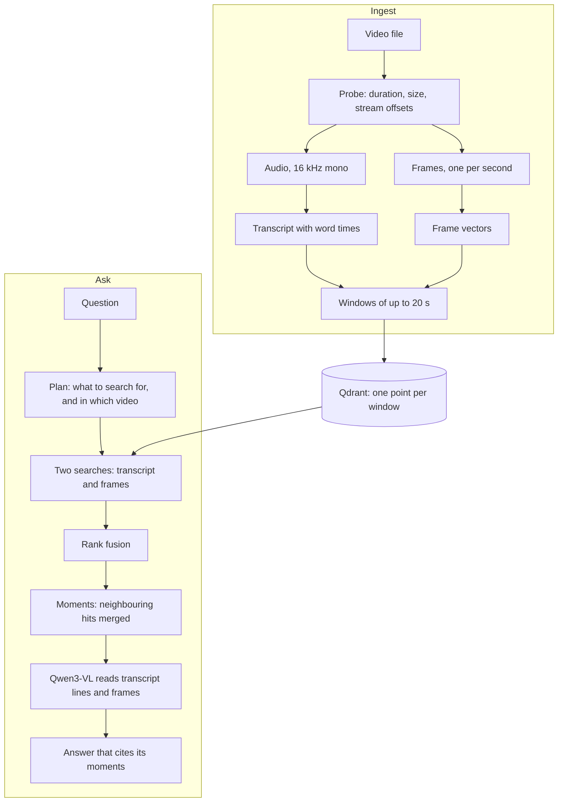

# Multimodal Video RAG Engine

Ask questions about your videos in natural language. Speech transcripts and video frames are aligned on a single timeline and indexed in a vector database, so a question returns the matching moments and an answer grounded in what was said and shown.

Everything runs on your own machine, in Docker. FFmpeg and [faster-whisper](https://github.com/SYSTRAN/faster-whisper) turn a video into a timeline. [Qwen3-Embedding](https://huggingface.co/Qwen/Qwen3-Embedding-0.6B) and [SigLIP 2](https://huggingface.co/google/siglip2-so400m-patch14-384) index it in [Qdrant](https://qdrant.tech). [Qwen3-VL](https://ollama.com/library/qwen3-vl) plans each search and writes answers that cite the moments they rest on. [Ollama](https://ollama.com) runs both Qwen models.

**Contents:** [Status](#status) · [How it works](#how-it-works) · [Requirements](#requirements) · [Quick start](#quick-start) · [Ingest a video](#ingest-a-video) · [Search](#search) · [Ask a question](#ask-a-question) · [Evaluate retrieval](#evaluate-retrieval) · [Configuration](#configuration) · [Services and storage](#services-and-storage) · [Run on a rented VM](#run-on-a-rented-vm) · [Project layout](#project-layout) · [If something goes wrong](#if-something-goes-wrong) · [Known limits](#known-limits) · [Roadmap](#roadmap)

## Status

This is an academic project in early development, built in small steps.

Implemented:

- Ingestion: metadata, audio, frames and a transcript with word times.
- Search over what is said and over what is shown, alone or fused.
- A query planner that narrows a search to the video a question names.
- Answers that cite the moments they rest on.
- An evaluation of retrieval, with [first results](#baseline-results).
- GPU support for the containers that run models.

Not implemented yet: a web UI, speaker labels, emotion, sound search and on-screen text. See the [roadmap](#roadmap).

## How it works



### Ingest: from a video to a timeline

`python -m vrag.ingest` takes one video through six stages and keeps everything it produces in `data/artifacts/<video_id>/`. The id is the first 16 hex characters of the file's SHA-256, so the same file always lands in the same folder.

| Stage | What it does | Output |
|---|---|---|
| Probe | `ffprobe` reads the duration, the size as displayed, the frame rate, whether it varies, and where the video and audio streams start | `video` in `timeline.json` |
| Audio | FFmpeg writes 16 kHz mono audio. If the audio stream starts late, the gap is filled with silence, so audio and video share one clock | `audio.wav` |
| Frames | FFmpeg keeps the first frame of every second at full resolution, and the real timestamp of each is recorded | `frames/*.jpg` |
| Transcript | faster-whisper transcribes the audio, with voice activity detection and a timestamp for every word | `segments` in `timeline.json` |
| Frame vectors | SigLIP 2 turns every frame into a vector of 1152 numbers | `frame_vectors.npy` |
| Index | The video is cut into windows, and each window becomes one point in Qdrant | `windows` in `timeline.json` |

Every stage records its version and settings in `timeline.json`. Running the command again skips what is still valid and redoes what changed, for example after picking another Whisper model.

All times are seconds on the video's presentation timeline, the clock a player shows. A time from the index can therefore be used directly to seek in the video.

### Windows: what gets indexed

A window is a stretch of at most 20 seconds, and the windows together cover the whole video:

- Transcript segments are grouped into one window until it would pass 20 seconds or a pause of more than 2 seconds comes.
- Every stretch of 2 seconds or more without speech gets windows of its own, so silent scenes can be found too.

Each window is one point in Qdrant, with up to two vectors:

- `text` is the window's transcript, embedded with Qwen3-Embedding. A window without speech has none.
- `frame` holds the SigLIP 2 vectors of the window's frames, including those up to one second around it. A query is compared with every frame, and the best match counts.

### Planning: what to search for, and where

Before a search, Qwen3-VL reads the question and writes a small plan as JSON: the text to search for, and the video to search in when the question names one, as in "in the cooking video, when do they add the garlic?". Ollama holds the model to the JSON form, and the plan is validated before it is used.

So far the video is the only thing a plan decides. The rest of the question passes through word for word: a plan may leave words out, but a plan with words of its own is set aside and the question is searched as it is. The same happens when the planner is off or fails. Filters for speakers, emotion and sounds will join the plan as those features arrive.

### Search: two rankings, fused by rank

A query is embedded twice: by Qwen3-Embedding, and by SigLIP 2's text encoder, which places text in the same space as the frames. Qdrant returns one ranking for each. For Qwen3-Embedding the query starts with a one-sentence instruction that describes the task, as the model expects; transcripts are embedded as they are.

The two rankings are combined by weighted reciprocal rank fusion. A window scores `weight / (60 + rank)` in each ranking it appears in, and the two scores are added. Only ranks are combined, because similarity scores from two different models cannot be compared. A window that both searches find gets both contributions, so agreement lifts it.

### Answers: evidence in, citations out

`/ask` plans and searches first, and then:

1. Merges hits of the same video that follow each other, at most 2 seconds apart, into one moment. Moments are numbered by their best hit.
2. Collects each moment's transcript lines with their start times, and about three frames per hit, spread over the moment and scaled down to 768 pixels on the longer side.
3. Sends the question and the moments to Qwen3-VL. The model is told to use only this evidence, to cite moments as `[1]`, `[2]`, and to say so when the evidence does not answer the question.
4. Returns the answer together with the numbered moments, so every citation leads to a video and a time range.

The context size goes with every request. Ollama's own default depends on the GPU's memory, and a prompt longer than the context would otherwise lose its oldest part without notice. When a prompt would not fit, frames are left out, starting with the lowest-ranked moments.

### Models

| Role | Model | Where it runs |
|---|---|---|
| Speech to text | Whisper `small`, through faster-whisper | `worker`; CPU by default |
| Vectors for transcripts and text queries | Qwen3-Embedding 0.6B (1024 numbers per vector, 100+ languages) | `ollama`; GPU if there is one |
| Vectors for frames and visual queries | SigLIP 2 (`so400m`, 384 px) | `worker` at ingest, `embedder` for queries; GPU if there is one |
| Search plans and answers | Qwen3-VL 8B, Instruct edition | `ollama`; GPU if there is one |

All four can be changed in [the settings](#configuration).

## Requirements

- Docker with the Compose plugin.
- About 12 GB of disk for the models (Qwen3-VL 6.2 GB, SigLIP 2 4.5 GB, Qwen3-Embedding 0.6 GB, Whisper `small` 0.5 GB), plus several GB for the container images. The `worker` image includes PyTorch.
- Recommended: an NVIDIA GPU with the NVIDIA Container Toolkit installed on the host. The project is developed for a single GPU with 16 to 24 GB of memory. Without a GPU everything still runs, but embedding frames and writing answers are slow.

Docker gives containers an NVIDIA GPU on Linux and under WSL2 only.

## Quick start

```bash
git clone https://github.com/Khaledblel/multimodal-video-rag-engine.git
cd multimodal-video-rag-engine
mkdir -p data/media
cp .env.example .env
```

With an NVIDIA GPU, uncomment the last line of `.env` (`COMPOSE_FILE=compose.yaml:compose.gpu.yaml`), so the containers that run models can use it. Then start the stack:

```bash
docker compose up -d --build
curl localhost:8000/health
```

The health check answers `"status": "ok"` once Qdrant is reachable and `data/` is writable. Next, download the two models that Ollama runs: the text embedder, and the model that plans searches and writes answers. The same command checks that both work:

```bash
docker compose exec worker python -m vrag.tools.ollama_check --pull
```

Put a video in `data/media/` and ingest it. The first run downloads the Whisper and SigLIP 2 models:

```bash
docker compose exec worker python -m vrag.ingest /data/media/clip.mp4
```

Now search it, or ask about it:

```bash
curl -G localhost:8000/search --data-urlencode 'q=when do they talk about the budget'
curl -G localhost:8000/ask --data-urlencode 'q=what do they decide about the budget?'
```

Notes:

- With a GPU, `docker compose exec worker python -m vrag.tools.gpu_check` confirms that the containers see it.
- The containers run as user id 1000 and write to `./data`. If your own user has another id, hand the folder over: `sudo chown -R 1000:1000 data`.
- After editing `.env`, run `docker compose up -d` again so the containers pick up the change.
- `docker compose down` stops everything and keeps the index and the downloaded models. `docker compose down -v` deletes them as well.

## Ingest a video

```bash
docker compose exec worker python -m vrag.ingest /data/media/clip.mp4
```

Any file that FFmpeg can read and that has a video stream works. A video without sound gets no transcript, and can still be searched by what it shows.

The command shows a progress bar while it transcribes and ends with a summary: the `video_id`, the duration, and the number of frames, transcript segments and windows. The artifacts are in `data/artifacts/<video_id>/`:

- `timeline.json`: the video's metadata, the frame list, the transcript with word times, the windows, and a record of each finished stage. `backend/samples/timeline.sample.json` shows the format.
- `audio.wav`: the audio as 16 kHz mono.
- `frames/`: one JPEG per second, `000000.jpg` onwards.
- `frame_vectors.npy`: one vector per frame.

Finished stages are skipped on later runs. `--force` redoes them all.

Related commands, all run with `docker compose exec worker`:

| Command | What it does |
|---|---|
| `python -m vrag.tools.show_transcript VIDEO_ID --words` | Prints the transcript with the time of every sentence and word |
| `python -m vrag.tools.sync_check` | Generates a 10-second clip with flashes and beeps at known times, ingests it, and prints PASS or FAIL for four checks of timestamp handling. The clip is taken out of the search index afterwards |
| `python -m vrag.tools.check_timeline PATH` | Validates a `timeline.json` against the schema |

## Search

```bash
curl -G localhost:8000/search --data-urlencode 'q=when do they talk about the budget'
curl -G localhost:8000/search --data-urlencode 'q=a red car at night' -d mode=frame
```

| Parameter | Default | Meaning |
|---|---|---|
| `q` | required | The query, up to 500 characters |
| `mode` | `fused` | `fused` searches both ways, `text` only what is said, `frame` only what is shown |
| `video_id` | every video | Search a single video |
| `limit` | `5` | Number of hits, 1 to 50 |
| `plan` | the `PLANNER_ENABLED` setting | `false` searches with the query as it is, `true` sends it through the planner |

A response looks like this:

```json
{
  "query": "when do they talk about the budget",
  "collection": "windows_qwen3-embedding-0-6b_1024_google-siglip2-so400m-patch14-384_1152",
  "mode": "fused",
  "plan": {"text": "when do they talk about the budget", "video_id": null, "planned": true, "error": null},
  "hits": [
    {
      "video_id": "0123456789abcdef",
      "source_name": "meeting.mp4",
      "window_id": 7,
      "start": 42.0,
      "end": 58.6,
      "text": "So the budget for next year ...",
      "score": 0.0325,
      "text_rank": 1,
      "frame_rank": 2
    }
  ]
}
```

`start` and `end` are seconds. `text_rank` and `frame_rank` are the window's position in each of the two searches, or `null` when that search did not find it. In a fused search `score` is the fused rank score described [above](#search-two-rankings-fused-by-rank). With `mode=text` it is the cosine similarity of the transcript, and with `mode=frame` that of the best-matching frame.

`plan` shows what was searched: the `text`, and the `video_id` when the search was narrowed to one video. `planned` is `true` when the model wrote the plan, and `false` when the query passed through as it is: the planner was off, the request gave a `video_id`, fewer than two videos are indexed, or the planner failed, in which case `error` says why.

A search covers every indexed video unless `video_id` or the plan narrows it. Each combination of embedding models has its own collection in Qdrant, so after changing a model, ingest the videos again to fill the new one.

## Ask a question

```bash
curl -G localhost:8000/ask --data-urlencode 'q=what do they decide about the budget?'
```

| Parameter | Default | Meaning |
|---|---|---|
| `q` | required | The question, up to 500 characters |
| `limit` | `5` | Search hits to answer from, 1 to 10 |
| `frames` | `3` | Frames per hit, 0 to 5. With 0 the answer comes from the transcript alone |
| `mode` | `fused` | How to search, as for `/search` |
| `video_id` | every video | Answer from a single video |
| `plan` | the `PLANNER_ENABLED` setting | Whether the planner prepares the search, as for `/search` |
| `stream` | `false` | `true` sends the answer while it is written |

A response looks like this:

```jsonc
{
  "query": "what do they decide about the budget?",
  "mode": "fused",
  "plan": {"text": "what do they decide about the budget?", "video_id": null, "planned": true, "error": null},
  "answer": "They agree to cut travel spending, at 0:51 [1].",
  "citations": [1],
  "moments": [
    {
      "n": 1,
      "video_id": "0123456789abcdef",
      "source_name": "meeting.mp4",
      "start": 42.0,
      "end": 63.2,
      "score": 0.0325,
      "window_ids": [7, 8],
      "lines": [{"start": 42.0, "end": 47.9, "text": "So the budget for next year ..."} /* and the other lines */],
      "frames": [{"index": 45, "t": 45.0} /* and the other frames */]
    }
  ],
  "stats": {/* described below */}
}
```

- `plan` is what the search used, as for `/search`. The model still answers the question as it was asked.
- `answer` cites the moments it rests on as `[1]`, `[2]`.
- `moments` lists every moment the model was given: its number `n`, its video, its start and end in seconds, its transcript `lines`, and the `frames` that were sent.
- `citations` are the numbers the answer used. A number that matches no moment is dropped.
- `stats` reports what the answer cost: hits, moments and frames, the prompt's size in tokens next to the context size, the answer's tokens, the time to plan, to search, to the first token and in total, and how much memory the model takes and how much of it is on the GPU. The API logs the same as one line per answer.

With `stream=true` the reply is newline-delimited JSON, one event per line:

```jsonc
{"type": "moments", "query": "...", "mode": "fused", "plan": {/* as above */}, "moments": [/* as above */]}
{"type": "token", "text": "They"}
{"type": "token", "text": " agree"}
{"type": "done", "answer": "...", "citations": [1], "stats": {/* as above */}}
```

A failure after the stream has started arrives as `{"type": "error", "detail": "..."}`. A model that reasons before it answers also sends `thinking` events before its tokens.

From a terminal, this prints the moments, the answer as it is written, the moments it cited and the stats:

```bash
docker compose exec worker python -m vrag.answer "what do they decide about the budget?"
```

It takes `--video VIDEO_ID`, `--limit`, `--frames`, `--mode` and `--no-plan`. To see only the plan for a question, with the list of videos the planner chooses from:

```bash
docker compose exec worker python -m vrag.planner "in the cooking video, when do they add the garlic?"
```

FastAPI also serves interactive documentation of all three endpoints at `http://localhost:8000/docs`.

## Evaluate retrieval

`backend/eval/queries.json` holds labeled queries. Each has a `category` (`speech`, `visual`, `speaker_emotion`, `small_object` or `multimodal`; speech and visual queries are searchable so far) and one or more target time spans:

```json
{
  "tolerance_s": 2.0,
  "sources": {"0123456789abcdef": "where the clip comes from"},
  "queries": [
    {"id": "q01", "category": "speech", "query": "when do they talk about the budget",
     "targets": [{"video_id": "0123456789abcdef", "start": 42.0, "end": 51.5}]}
  ]
}
```

```bash
docker compose exec worker python -m vrag.evaluate
```

This prints Recall@1/5/10 and MRR per category, once for each way of searching (`text`, `frame` and `fused`), and saves them in `data/eval/`. A hit counts when it overlaps a target, give or take `tolerance_s`. Each query is searched across every indexed video.

Queries are searched as they are. With `--plan` each one goes through the planner first, and the output adds how many plans the model wrote, how many changed the text, how many chose a video and how many failed. Comparing the two runs shows what the planner changes.

The file in the repository is empty. It is built into the worker image, so rebuild after editing it (`docker compose up -d --build`), or pass another path, such as one under `/data`.

### Baseline results

The first measurement, with transcript search only (November 2026):

| Category | Queries | Recall@1 | Recall@5 | Recall@10 | MRR |
|---|---|---|---|---|---|
| speech | 20 | 0.650 | 0.800 | 0.900 | 0.727 |

- **Data:** 5 clips, 17 minutes in total, with 20 labeled speech queries. Each query is searched across every indexed clip.
- **Setup:** faster-whisper `small` transcripts (int8, CPU), windows of up to 20 seconds, `sentence-transformers/all-MiniLM-L6-v2` embeddings (384 dimensions, cosine similarity) and a tolerance of 2 seconds.
- **Reading:** the right moment was the top hit for 13 of the 20 queries, in the top 5 for 16 and in the top 10 for 18. Two queries had no correct hit in the top 10.
- **Limits:** this is a single run on a small set. Each query is worth 0.05 of recall, so only large differences between setups are meaningful, and only speech queries are covered so far.

These numbers come from the first text embedder, MiniLM, a small English-only model. It has since been replaced by [Qwen3-Embedding-0.6B](https://huggingface.co/Qwen/Qwen3-Embedding-0.6B), a larger multilingual model. If retrieval quality becomes the limit, the next options are a larger size of that model, a re-ranker over the top hits, or both.

## Configuration

Every setting has a default, listed in `.env.example`. To change one, set it in `.env` and run `docker compose up -d` again. Each part can be switched off on its own.

**General**

| Setting | Default | Meaning |
|---|---|---|
| `API_BIND` | `127.0.0.1` | Address the API is published on. The default keeps it on the local machine |
| `API_PORT` | `8000` | Port the API is published on |
| `LOG_LEVEL` | `INFO` | Log level of the project's containers |
| `COMPOSE_FILE` | not set | `compose.yaml:compose.gpu.yaml` gives the containers that run models the NVIDIA GPU |

**Transcript**

| Setting | Default | Meaning |
|---|---|---|
| `ASR_ENABLED` | `true` | `false` skips transcription |
| `ASR_MODEL` | `small` | Any faster-whisper model, for example `large-v3` |
| `ASR_DEVICE` | `cpu` | `cuda` runs it on the GPU |
| `ASR_COMPUTE_TYPE` | `int8` | Use `float16` on a GPU |
| `ASR_LANGUAGE` | empty | A language code such as `en`. Empty detects the language |

**Search**

| Setting | Default | Meaning |
|---|---|---|
| `INDEX_ENABLED` | `true` | `false` skips indexing |
| `TEXT_EMBED_MODEL` | `qwen3-embedding:0.6b` | Another size of Qwen3-Embedding from Ollama's library: `qwen3-embedding:4b` or `qwen3-embedding:8b` |
| `TEXT_EMBED_DIM` | `1024` | The vector size of that model: 2560 for `4b`, 4096 for `8b` |
| `FRAME_EMBED_ENABLED` | `true` | `false` turns frame vectors and frame search off. Windows then come from speech only |
| `FRAME_EMBED_MODEL` | `google/siglip2-so400m-patch14-384` | Another fixed-resolution SigLIP checkpoint |
| `FRAME_EMBED_DIM` | `1152` | The vector size of that checkpoint |
| `EMBED_DEVICE` | `auto` | `auto` uses the GPU when there is one. `cpu` or `cuda` decides it |
| `FUSION_TEXT_WEIGHT` | `1.0` | Weight of the transcript ranking in a fused search |
| `FUSION_FRAME_WEIGHT` | `1.0` | Weight of the frame ranking in a fused search |

**Planner and answers**

| Setting | Default | Meaning |
|---|---|---|
| `VLM_ENABLED` | `true` | `false` turns answers and the planner off |
| `PLANNER_ENABLED` | `true` | `false` searches with every question as it is |
| `VLM_MODEL` | `qwen3-vl:8b-instruct` | Another vision model from Ollama's library, such as `qwen3-vl:4b-instruct` for a smaller GPU |
| `VLM_NUM_CTX` | `16384` | Context size in tokens |
| `VLM_FRAME_SIDE` | `768` | The longer side, in pixels, that frames are scaled down to |
| `VLM_KEEP_ALIVE` | `5m` | How long the model stays in memory after an answer. `0` unloads it at once, `-1` keeps it |
| `VLM_THINK` | `false` | `true` lets a Thinking edition, such as `qwen3-vl:8b`, reason before it answers |
| `OLLAMA_URL` | `http://ollama:11434` | Another Ollama server, for example one on the host (`http://host.docker.internal:11434` with Docker Desktop) |

## Services and storage

| Service | Image | What it does |
|---|---|---|
| `api` | built from `backend/Dockerfile.api` | The HTTP API: `/health`, `/search` and `/ask`. A light image without PyTorch |
| `worker` | built from `backend/Dockerfile.worker` | An idle container with FFmpeg, faster-whisper and PyTorch. Ingestion, evaluation and the checks run in it through `docker compose exec worker` |
| `embedder` | the `worker` image | A small internal service that embeds search queries with SigLIP 2, so the API needs no PyTorch |
| `qdrant` | `qdrant/qdrant:v1.20.0` | The vector database |
| `ollama` | `ollama/ollama:0.40.16` | Runs the text embedder and the model that plans searches and writes answers |

Only the API publishes a port, on the local machine by default.

Where things are kept:

- `./data/media/` is where you put videos, `./data/artifacts/` holds what ingestion produces, and `./data/eval/` the evaluation results. `data/` is not tracked by git.
- The volume `qdrant_storage` holds the index, `models` the downloaded Whisper and SigLIP 2 models, and `ollama` the two models that Ollama runs.

## Run on a rented VM

The scripts in `deploy/vm/` set the stack up on a fresh Ubuntu VM, for anyone who would rather rent a GPU than use their own. They are written for Ubuntu 24.04 and are not tied to a provider.

- `bootstrap.sh` installs Docker if it is missing, creates `.env`, turns on the GPU file when `nvidia-smi` works, builds and starts the stack, and then runs the GPU check and the model check. From a clone on the VM: `bash deploy/vm/bootstrap.sh`.
- `sync.sh USER@HOST` uploads your working copy to `/opt/vrag` on the VM and runs the bootstrap there.
- `cloud-init.yaml` is user data for providers that accept it. It clones this repository and runs the bootstrap.

The API stays on the VM's own loopback address. Reach it through an SSH tunnel, then use `localhost:8000` as above:

```bash
ssh -L 8000:localhost:8000 USER@HOST
```

## Project layout

```text
.
├── compose.yaml            the stack: qdrant, ollama, api, worker, embedder
├── compose.gpu.yaml        gives the containers that run models the NVIDIA GPU
├── .env.example            every setting with its default
├── backend/
│   ├── Dockerfile.api      light image for the API
│   ├── Dockerfile.worker   FFmpeg, faster-whisper and PyTorch; also runs the embedder
│   ├── requirements*.txt   direct dependencies of the two images
│   ├── constraints*.txt    pinned versions of everything they install
│   ├── eval/queries.json   labeled queries for the evaluation (empty in the repository)
│   ├── samples/            a sample timeline.json
│   └── vrag/
│       ├── ingest.py       the ingest stages and their command line
│       ├── media.py        ffprobe and FFmpeg calls
│       ├── asr.py          transcription
│       ├── vision.py       SigLIP 2 vectors for frames and queries
│       ├── index.py        windows, indexing, search and fusion
│       ├── planner.py      the query planner and its command line
│       ├── answer.py       moments, prompt and answer, and their command line
│       ├── ollama.py       calls to Ollama
│       ├── embedder.py     the query embedding service
│       ├── evaluate.py     the retrieval evaluation
│       ├── main.py         the API
│       ├── config.py       settings
│       ├── artifacts.py    artifact paths, loading and saving timelines
│       ├── schemas/        data models: timeline, search, answer, evaluation set
│       └── tools/          checks: sync_check, gpu_check, ollama_check, show_transcript, check_timeline
└── deploy/vm/              scripts for a fresh Ubuntu VM
```

## If something goes wrong

- **`/health` says `data_dir` is not ok.** The containers cannot write to `./data`. See the note on user id 1000 in the [quick start](#quick-start).
- **A request answers 503, or an ingest stops, saying a model is not downloaded.** Run `docker compose exec worker python -m vrag.tools.ollama_check --pull`.
- **An ingest stops with `no reply from Ollama`.** Ollama embeds the transcript for the index. Check that it runs: `docker compose ps ollama`. Running the ingest again continues from the stage that stopped.
- **`/search` or `/ask` answers 503 with `embedder unavailable`.** The embedder is still starting or has stopped: `docker compose logs embedder`.
- **The first query is slow.** Each model loads on first use, and the model that writes answers is unloaded again after `VLM_KEEP_ALIVE`.
- **A search finds nothing after a model was changed.** The new combination of models has an empty collection until the videos are ingested again.
- **No GPU in the containers.** `docker compose exec worker python -m vrag.tools.gpu_check` says whether PyTorch sees one. Check that `COMPOSE_FILE` is set in `.env` and that the NVIDIA Container Toolkit is installed.

## Known limits

- The planner narrows a search only when the question names a video, and it chooses among at most 200 indexed videos.
- Frame search reads short queries. SigLIP 2's text encoder takes 64 tokens, and a longer query is cut.
- Frames are sampled once per second, so something visible for less than a second can be missed.
- An answer's citations are checked against the moments it was given. The times it states in its text are not.
- There is no authentication. Keep the API on the local machine, or put it behind something that authenticates. Qdrant and Ollama are never published.

## Roadmap

Planned, roughly in this order:

- A web UI: upload a video, ask, and jump to the cited moment.
- Who speaks: speaker labels on the transcript.
- How it is said: emotion heard in the voice.
- What is heard: search over sounds.
- What is on screen: text and objects, read by the vision-language model at ingest.
- An enriched transcript that brings all of these together for the model that writes answers.
- Ablations that show what each part adds, and tuned fusion weights.
